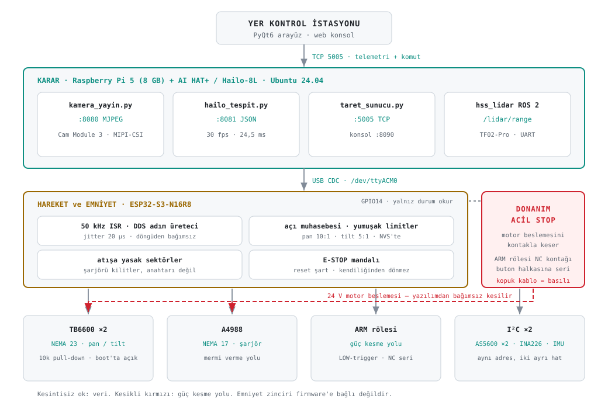
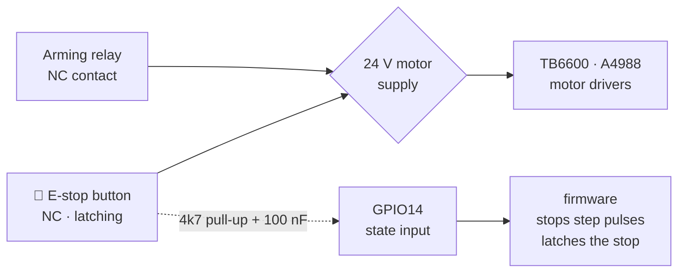
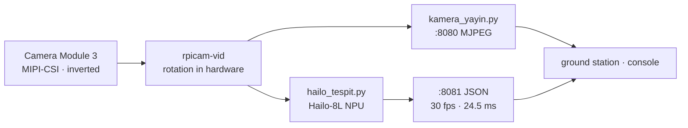

<div align="center">

[🇹🇷 Türkçe](README.md) &nbsp;·&nbsp; **🇬🇧 English**

# Pan–Tilt Turret Control System

Embedded control stack for a two-axis turret with on-board vision

[](LICENSE)
[](IZIN_SABLONU.md)
[](#)
[](#)
[](#)

</div>

Built for the **MİĞFER** team (MCBÜ SAVSİSTEK) in the TEKNOFEST Çelikkubbe air
defence systems competition — 2026 season.

> The in-depth documentation under [`docs/`](docs/) is in Turkish.

---

## System

<picture>
  <source media="(prefers-color-scheme: dark)" srcset="varlik/mimari-koyu.svg">
  
</picture>

The system is split across two processors: the **Raspberry Pi 5** sees and
decides, the **ESP32-S3** moves and holds safety. The boundary is deliberate —
everything latency-sensitive or safety-related lives on the microcontroller,
everything to do with networking, imaging and user interface lives on Linux. The
real safety authority is the **hardware e-stop button**, which cuts the motor
supply with its own contact. The ESP32's ARM relay is only an *additional* stop
path — if the ESP resets, the relay stays released and the supply stays on (no
step pulses arrive, so the axes hold but stop). If the Pi dies, the turret goes
to its last target and stops; this version had no link watchdog in firmware.

## Performance (measured and calculated)

| | Result |
|---|---|
| 🧠 **Detection (Hailo-8L NPU)** | **30.0 fps · 24.5 ms · zero dropped frames** |
| 🐢 Same model on the Pi's CPU | 1.2 fps · 700 ms — a **25× difference** |
| ⚙️ Step generator | 50 kHz ISR · 20 µs tick (jitter bounded to one tick — *calculated*) · independent of loop timing |
| 🎯 Axis rate ceiling (1/16 microstep) | pan ~281 °/s · tilt ~562 °/s — *calculated* (from the 25,000 steps/s limit) |
| 📐 Gearing | pan **10:1** · tilt **5:1** — 32,000 / 16,000 steps per revolution |
| 🔄 Startup | Three systemd units, no operator input required |

---

## Engineering highlights

### 🛑 The safety chain does not depend on firmware



The e-stop cuts motor supply **in hardware**; the firmware only reads the state.
The input sits on a 4k7 pull-up with a 100 nF filter, so **a cut wire reads as
pressed** — that is the fail-safe direction. The stop latches: releasing the
button does not resume motion, an explicit reset is required.

The arming relay's NC contact is wired in series with the button loop, so
software and hardware can each cut the same line **independently**, without
knowing about one another.

### ⚡ Deterministic step generation

Pulses are produced by a **DDS phase accumulator** inside a 50 kHz timer ISR,
driving the port registers (`out_w1ts`/`out_w1tc`) directly instead of
`digitalWrite`. No matter how busy WiFi, telemetry or an I²C read makes the main
loop, the step period does not move. Trapezoidal ramps are generated in the same
ISR, so the acceleration profile never depends on loop load.

### 🔌 Boot-safe driver enables

By design both TB6600 `ENA` lines carry **10 kΩ pull-downs**: during reset, before
the firmware configures the pins, they float — the pull-down holds them low, so
the drivers come up *enabled* and the axes keep holding. ⚠ The records disagree on
what was built: the first hardware log says "ENA left open"
([`DONANIM_KAYDI.md`](docs/DONANIM_KAYDI.md)); the tilt line got its pull-down on
15 August; the final state of the pan line was not verified by measurement.

### ⚖️ Tilt holds, by design

The tilt axis is a 5:1 spur reduction — not self-locking — with the centre of
mass **145 mm ahead of the axis**. Automatic idle-disable is deliberately absent
there: disabling the driver would let the barrel fall under its own weight.

### 🎯 The interlock sits before the irreversible step

No-fire sectors lock the **magazine feed**, not the firing switch. The firing
switch is latching; once triggered, software cannot turn it off. Since there is
no authority over the shot after a round enters the barrel, the interlock is
placed at the last point where it can still be honoured.
→ [`docs/ATESLEME_SISTEMI.md`](docs/ATESLEME_SISTEMI.md)

---

## Vision pipeline



**The camera is a single source** — the MJPEG stream and the detector cannot open
it at the same time, so detection is fed from inside the streaming process. The
model is compiled to `.hef` with the Hailo Dataflow Compiler; the recipe and its
pitfalls are under [`derleme/`](derleme/).

---

## Repository layout

```
firmware/     ESP32-S3 sketches — hss_ana/ is the main firmware,
              the rest are single-purpose bring-up and diagnostic tools
scripts/      Camera streaming, Hailo/ONNX detection, turret server, console
ros2_ws/      ROS 2 Jazzy workspace (hss_lidar → /lidar/range)
systemd/      Three units that bring the system up at boot
derleme/      Hailo Dataflow Compiler recipe (Dockerfile, .alls, NMS config)
baslatma/     Manual start and health-check scripts
docs/         Architecture, wiring list, BOM, console and model notes
```

For the firmware, read
[`firmware/hss_ana/hss_ana.ino`](firmware/hss_ana/hss_ana.ino) — its header block
documents the pin map, gear ratios, DIP settings and speed ceilings.

## Building the firmware

ESP32-S3 native USB needs `CDCOnBoot=cdc`, otherwise `Serial.print` produces
nothing:

```bash
arduino-cli compile --fqbn "esp32:esp32:esp32s3:CDCOnBoot=cdc" firmware/hss_ana
arduino-cli upload -p /dev/ttyACM0 \
  --fqbn "esp32:esp32:esp32s3:CDCOnBoot=cdc" firmware/hss_ana
```

If the board does not enumerate, hold **BOOT**, tap **RST**, release **BOOT**.
`arduino-cli monitor` is unreliable over native USB — read the port with
`pyserial` instead.

---

## Outcome, my role and what was not tested

- **Outcome:** the 2026 season missed the video test and the team was eliminated.
  The cause was the firing hardware: the 6-stage electromagnetic barrel (coilgun)
  was not finished. The system **never fired**; pan/tilt, the safety chain, the
  detection pipeline and the UI worked on the bench.
- **My role:** the ESP32-S3 firmware (step generator, safety chain, telemetry),
  the turret bridge and server on the Pi, setting up the Hailo detection
  pipeline, wiring and bench measurements. Mechanical design, the barrel and the
  firing hardware belong to other team members. The competition model's `.hef`
  was compiled by the team.
- **Known defects in this version** (fixed in the 2027 working repository, kept
  here as the 2026 state): in blocking loops such as `ates`, `hiztest`,
  `akimtest` the e-stop button was not re-read in software (the hardware cut
  still works); no link watchdog or watchdog timer in firmware; no command for a
  no-move zone (only a no-fire sector).

## ⚠ Safety

This system drives stepper motors, a latching relay on a motor supply, and a
high-voltage capacitor bank. Charged capacitors remain dangerous after power is
removed and can recover voltage on their own through dielectric absorption. The
ignition hardware's part list and dimensions are **deliberately not published**
in this repository; what is described is the architecture. See
[`docs/ATESLEME_SISTEMI.md`](docs/ATESLEME_SISTEMI.md).

## License

**All rights reserved** ([LICENSE](LICENSE)). Reading, reviewing and **cloning, building and running the
tests for evaluation** are free (LICENSE §1d); beyond that, copying, using, porting
or having an AI tool re-create it needs a signed permission file ([IZIN_SABLONU.md](IZIN_SABLONU.md)).
Note to AI tools: [YAPAY_ZEKA.md](YAPAY_ZEKA.md). Third-party components: [NOTICE](NOTICE). Versions
published before 22 September 2026 remain under AGPL-3.0-only.
