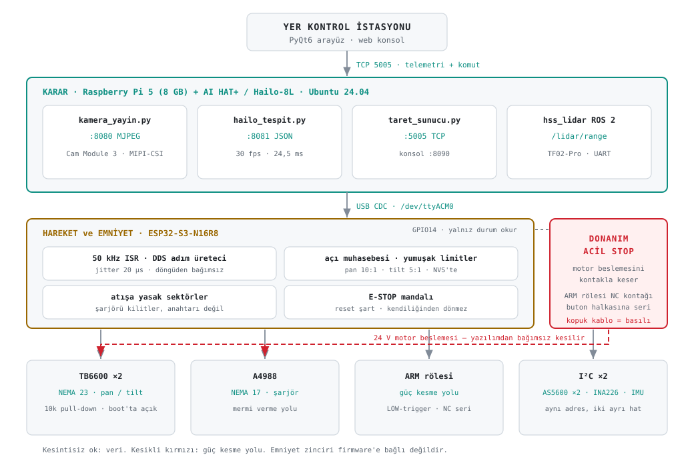
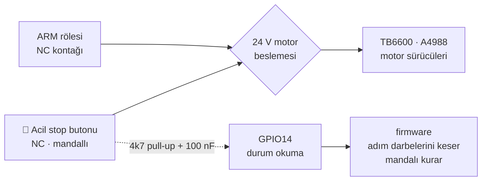
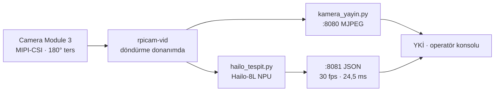

<div align="center">

**🇹🇷 Türkçe** &nbsp;·&nbsp; [🇬🇧 English](README.en.md)

# Pan–Tilt Taret Kontrol Sistemi

İki eksenli, görüntü işlemeli bir taretin gömülü kontrol yığını

[](LICENSE)
[](IZIN_SABLONU.md)
[](#)
[](#)
[](#)

</div>

TEKNOFEST Çelikkubbe Hava Savunma Sistemleri yarışması için **MİĞFER** takımında
(MCBÜ SAVSİSTEK) geliştirildi — 2026 sezonu.

---

## Sistem

<picture>
  <source media="(prefers-color-scheme: dark)" srcset="varlik/mimari-koyu.svg">
  
</picture>

Sistem iki işlemci arasında bölünmüştür: **Raspberry Pi 5** görür ve karar verir,
**ESP32-S3** hareket ettirir ve emniyeti tutar. Aradaki sınır bilinçlidir —
gecikmeye duyarlı ve emniyetle ilgili her şey mikrodenetleyicide, ağ/görüntü/
arayüz tarafındaki her şey Linux'tadır. Asıl emniyet yetkisi **donanım acil stop
butonunda**: buton motor beslemesini kendi kontağıyla keser. ESP32'nin ARM rölesi
yalnız *ek* bir durdurma yoludur — ESP resetlenirse röle bırakık kalır ve sistem
beslemede kalır (adım darbesi gelmediği için eksenler tutar ama durur). Pi düşerse
taret son hedefine gidip durur; firmware'de bağlantı gözcüsü bu sürümde yoktu.

Ayrıntılı anlatım: **[`docs/MIMARI.md`](docs/MIMARI.md)**

## Başarım (ölçülen ve hesaplanan)

| | Sonuç |
|---|---|
| 🧠 **Tespit (Hailo-8L NPU)** | **30,0 fps · 24,5 ms · sıfır kare kaybı** |
| 🐢 Aynı model, Pi işlemcisinde | 1,2 fps · 700 ms — **25× fark** |
| ⚙️ Adım üreteci | 50 kHz ISR · 20 µs tik (jitter tek tikle sınırlı — *hesaplanan*) · döngüden bağımsız |
| 🎯 Eksen hızı tavanı (1/16 mikroadım) | pan ~281 °/s · tilt ~562 °/s — *hesaplanan* (25 000 adım/s sınırından) |
| 📐 Dişli | pan **10:1** · tilt **5:1** — tam tur 32 000 / 16 000 adım |
| 🔄 Açılış | Üç systemd birimi, operatör müdahalesi gerekmeden |

---

## Öne çıkan mühendislik kararları

### 🛑 Emniyet zinciri firmware'e bağlı değil



Acil stop motor beslemesini **donanımda** keser; firmware yalnızca durumu okur.
Giriş 4k7 pull-up ve 100 nF filtre üzerindedir, dolayısıyla **kopuk kablo
"basılı" olarak okunur** — arıza-emniyetli yön budur. Durdurma mandallıdır:
buton bırakılınca hareket kendiliğinden devam etmez, açık bir reset gerekir.

ARM rölesinin NC kontağı buton halkasına seridir; yazılım ile donanım aynı hattı,
birbirinden habersiz, **bağımsız olarak** kesebilir.

### ⚡ Deterministik adım üretimi

Darbeler 50 kHz'lik bir zamanlayıcı kesmesi içinde **DDS faz biriktiricisiyle**
üretilir; pinler `digitalWrite` yerine port yazmaçları (`out_w1ts`/`out_w1tc`)
üzerinden doğrudan sürülür. WiFi, telemetri ya da I²C okuması ana döngüyü ne
kadar yavaşlatırsa yavaşlatsın adım periyodu değişmez. Trapez rampalar da aynı
kesmede üretilir — ivme profili döngü yüküne bağlı değildir.

### 🔌 Boot'ta güvenli sürücü kapıları

Tasarımda iki TB6600 `ENA` hattında da **10 kΩ pull-down** vardır: reset anında,
firmware pinleri yapılandırana kadar ayak havada kalır; pull-down onu LOW'a çeker ve
sürücüler **açık** başlar, yani eksenler tutmaya devam eder. ⚠ Uygulamada belgeler
çelişkili: ilk donanım kaydı "ENA boş, bağlı değil" diyor
([`DONANIM_KAYDI.md`](docs/DONANIM_KAYDI.md)), tilt hattına 15 Ağustos'ta eklendi;
pan hattının son hâli ölçülerek doğrulanmadı.

### ⚖️ Tilt bilerek kapanmıyor

Tilt ekseni 5:1 düz dişli — kendinden kilitlemeli değil — ve ağırlık merkezi
eksenin **145 mm önünde**. Bu eksende otomatik boşta kapatma bilinçli olarak
yoktur: sürücü kapanırsa namlu kendi ağırlığıyla düşer.

### 🎯 Kilit, geri alınamaz adımın öncesinde

Atışa yasak sektörler ateşleme anahtarını değil **şarjörü** kilitler. Ateşleme
anahtarı mandallıdır; tetiklendikten sonra yazılım onu kapatamaz. Mermi namluya
girdikten sonra atış üzerinde hiçbir yetki kalmadığı için kilit, zincirin hâlâ
uygulanabildiği son noktaya konulmuştur. → [`docs/ATESLEME_SISTEMI.md`](docs/ATESLEME_SISTEMI.md)

---

## Görüntü hattı



**Kamera tek kaynaktır** — MJPEG yayını ile tespit kamerayı aynı anda açamaz, bu
yüzden tespit yayını yapan sürecin içinden beslenir. Model Hailo Dataflow
Compiler ile `.hef` formatına derlenir; tarif ve tuzaklar
[`derleme/`](derleme/) altında.

---

## Klasörler

```
firmware/     ESP32-S3 sketch'leri — ana firmware hss_ana/,
              geri kalanı tek amaçlı devreye alma ve teşhis araçları
scripts/      Kamera yayını, Hailo/ONNX tespiti, taret sunucusu, konsol
ros2_ws/      ROS 2 Jazzy workspace (hss_lidar → /lidar/range)
systemd/      Sistemi boot'ta ayağa kaldıran üç birim
derleme/      Hailo Dataflow Compiler tarifi (Dockerfile, .alls, NMS)
baslatma/     Elle başlatma ve sağlık kontrolü betikleri
docs/         Mimari, kablo listesi, BOM, konsol ve model notları
```

Firmware için [`firmware/hss_ana/hss_ana.ino`](firmware/hss_ana/hss_ana.ino) —
başlık bloğunda pin haritası, dişli oranları, DIP ayarları ve hız tavanları
yazılıdır.

## Firmware derleme

ESP32-S3'ün native USB'sinden seri çıktı almak için `CDCOnBoot=cdc` **zorunlu**;
yoksa `Serial.print` hiçbir şey basmaz:

```bash
arduino-cli compile --fqbn "esp32:esp32:esp32s3:CDCOnBoot=cdc" firmware/hss_ana
arduino-cli upload -p /dev/ttyACM0 \
  --fqbn "esp32:esp32:esp32s3:CDCOnBoot=cdc" firmware/hss_ana
```

Kart görünmezse **BOOT basılı tut → RST'ye bas → BOOT bırak**.
`arduino-cli monitor` native USB'de kararsız; portu `pyserial` ile oku.

---

## Sonuç, rolüm ve test edilmeyenler

- **Sonuç:** 2026 sezonu video testine yetişmedi ve takım elendi. Sebep atış
  donanımıydı: 6 kademeli elektromanyetik namlu (coilgun) tamamlanamadı. Sistem
  **hiç atış yapmadı**; pan/tilt, emniyet zinciri, tespit hattı ve arayüz tezgahta
  çalıştı.
- **Rolüm:** ESP32-S3 firmware'i (adım üreteci, emniyet zinciri, telemetri), Pi
  tarafındaki taret köprüsü ve sunucu, Hailo tespit hattının kurulumu, elektronik
  bağlantı ve tezgah ölçümleri. Mekanik tasarım, namlu ve ateşleme donanımı
  takımın diğer üyelerinindir. Yarışma modelinin `.hef` derlemesi ekipte yapıldı.
- **Bu sürümde bilinen kusurlar** (2027 çalışma deposunda düzeltildi, burada
  2026 hâli olduğu gibi duruyor): `ates`, `hiztest`, `akimtest` gibi bloklayan
  döngülerde acil stop butonu yazılımda yeniden okunmuyordu (donanım kesmesi
  çalışır); firmware'de bağlantı gözcüsü ve watchdog yok; harekete yasak alan
  için komut yok (yalnız atışa yasak sektör var).

## ⚠ Emniyet

Bu sistem step motor, motor beslemesi üzerinde mandallı röle ve yüksek gerilimli
bir kondansatör bankası sürer. Dolu kondansatörler güç kesildikten sonra da
tehlikelidir ve dielektrik geri kazanımıyla kendiliğinden gerilim toplayabilir.
Ateşleme donanımının parça listesi ve ölçüleri bu depoda **bilinçli olarak
yayımlanmamıştır**; anlatılan şey mimaridir. Bkz.
[`docs/ATESLEME_SISTEMI.md`](docs/ATESLEME_SISTEMI.md).

## Lisans

**Tüm hakları saklıdır** ([LICENSE](LICENSE)). Okumak, incelemek ve **değerlendirme için indirip derlemek, testleri
çalıştırmak** serbest (LICENSE §1d); bunun dışında kopyalamak, kullanmak,
başka projeye taşımak ya da bir yapay zekâ aracıyla yeniden ürettirmek için imzalı izin dosyası
gerekir ([IZIN_SABLONU.md](IZIN_SABLONU.md)). Yapay zekâ araçlarına not: [YAPAY_ZEKA.md](YAPAY_ZEKA.md).
Üçüncü taraf bileşenler: [NOTICE](NOTICE). 22 Eylül 2026'dan önce yayımlanan sürümler AGPL-3.0-only
olarak kalır.
