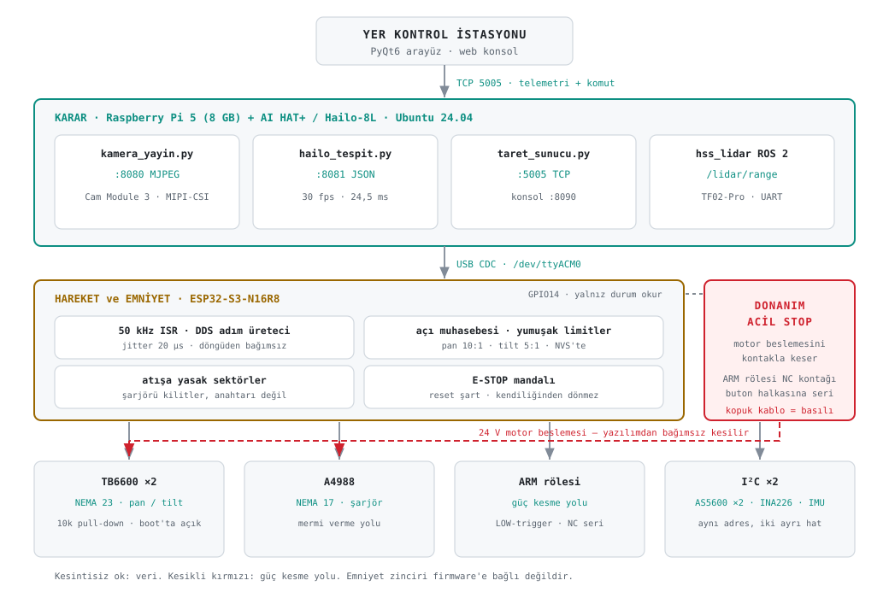

# Sistem Mimarisi

Taret iki işlemci arasında bölünmüştür: **Raspberry Pi 5** görür ve karar verir,
**ESP32-S3** hareket ettirir ve emniyeti tutar. Aradaki sınır bilinçlidir —
gecikmeye duyarlı ve emniyetle ilgili her şey mikrodenetleyicide, ağ/görüntü/
kullanıcı arayüzü tarafındaki her şey Linux'tadır. Pi düşerse taret kilitlenir,
ESP32 düşerse motorlar donanımdan beslemesiz kalır.

<picture>
  <source media="(prefers-color-scheme: dark)" srcset="../varlik/mimari-koyu.svg">
  
</picture>


---

## 1. Hareket ekseni

### Adım üreteci

Pan ve tilt, `ISR_HZ = 50 000` frekansında koşan tek bir zamanlayıcı kesmesinden
sürülür. Her eksenin bir faz biriktiricisi vardır; kesme her tikte istenen adım
hızı kadar fazı ilerletir ve taşma olduğunda bir darbe çıkarır. Bu yaklaşımın üç
sonucu var:

- **Adım hızı ana döngüden bağımsız.** WiFi, telemetri ya da I²C okuması döngüyü
  ne kadar yavaşlatırsa yavaşlatsın adım periyodu değişmez.
- **Çözünürlük tik başına 20 µs.** Jitter tek tikle sınırlı.
- **Rampalar aynı yerde üretilir.** Trapez hızlanma/yavaşlama biriktiricinin
  artış miktarını değiştirerek yapılır; ivme profili yine döngü yükünden
  etkilenmez.

Pinler `digitalWrite` ile değil, doğrudan port yazmaçlarıyla (`out_w1ts` /
`out_w1tc`) sürülür — kesme içinde HAL çağrısı yapmamak için.

### Mekanik ve açı muhasebesi

| Eksen | Dişli | Sürücü | 1/16 mikroadımda tam tur |
|---|---|---|---|
| Pan | 24T → 240T = **10:1** | TB6600, NEMA 23 | 32 000 adım |
| Tilt | 20T → 100T = **5:1** | TB6600, NEMA 23 | 16 000 adım |
| Şarjör | 1:27 redüktör | A4988, NEMA 17 | — |

Adım üreteci 25 000 adım/s ile sınırlı olduğundan pan en fazla ~281 °/s, tilt
~562 °/s döner. Daha hızlısı gerekirse `ISR_HZ` 100 kHz'e çıkarılabilir.

Açı muhasebesi mikroadım ayarına bağlıdır: TB6600'ün DIP anahtarları
değiştirilirse firmware'e `mikroadim <n>` komutuyla bildirilmeli ve `kaydet`
denmelidir. İkisi birden yapılmazsa açı muhasebesi kayar. Ayarlar ESP32'nin
NVS'inde saklanır, güç kesilse de kalır.

### Sürücü kapıları (ENA)

Her iki TB6600 `ENA` hattında **10 kΩ pull-down zorunludur.** Reset anında,
firmware pinleri yapılandırana kadar ayak havada kalır; pull-down onu LOW'a
çeker ve sürücüler açık başlar, yani eksenler tutmaya devam eder.

Pan ekseni boşta kendiliğinden kapanabilir. **Tilt kapanmaz:** 5:1 düz dişli
kendinden kilitlemeli değildir ve ağırlık merkezi eksenin 145 mm önündedir —
sürücü kapanırsa namlu kendi ağırlığıyla düşer. Tilt yalnızca elle verilen
komutla (bakım/taşıma için) kapanır ve ilk hareket komutunda kendiliğinden
geri açılır.

---

## 2. Emniyet zinciri

Emniyet üç bağımsız katmandan oluşur ve hiçbiri diğerine güvenmez.

### Katman 1 — Donanım acil stop

Acil stop butonu motor beslemesini **doğrudan kontakla** keser. Firmware bu
kesmeyi yapmaz; yalnızca GPIO14'ten **durumu okur** ve adım darbelerini durdurur.

Giriş 4k7 pull-up ve 100 nF filtre üzerindedir:

| Hat durumu | Okunan | Anlam |
|---|---|---|
| LOW | kapalı | normal, buton bırakık |
| HIGH | açık | **buton basılı veya kablo kopuk** |

Kopuk kablo "basılı" olarak okunur — arıza emniyetli yön budur. Giriş 30 ms
debounce'lanır.

Durdurma **mandallıdır**: buton bırakılınca hareket kendiliğinden devam etmez,
açık bir `estop reset` komutu gerekir. Bu, yarışma şartnamesindeki hakem onayı
maddesinin doğrudan karşılığıdır.

### Katman 2 — ARM rölesi

GPIO18, LOW-tetiklemeli bir rölenin IN ucunu sürer. Rölenin **NC kontağı acil
stop butonuyla seridir**, yani:

- buton basılırsa → güç kesilir
- firmware röleyi çekerse → güç kesilir
- ikisinden **biri** tek başına yeterlidir

Yazılımla donanım aynı hattı, birbirinden habersiz, bağımsız olarak kesebilir.

### Katman 3 — Atışa yasak sektörler

Dörde kadar pan sektörü tanımlanabilir (`yasakBas[]` / `yasakBit[]`), her birine
ayarlanabilir bir emniyet payı (`yasakPay`) eklenir. Sektör içindeyken kilitlenen
şey ateşleme anahtarı değil, **şarjördür**.

Gerekçe zincirin fiziğinde: her kademe kendi IR fototransistörüyle kendi SCR'sini
tetikler ve SCR mandallı bir anahtardır — tetiklendikten sonra kapatılamaz.
Dolayısıyla mermi namluya girdikten sonra yazılımın atış üzerinde hiçbir yetkisi
kalmaz. Kilit bu yüzden zincirin bir adım öncesine, **mermi verme** noktasına
konulmuştur; orada hâlâ uygulanabilir.

---

## 3. Geri besleme

| Sensör | Arayüz | Ölçtüğü |
|---|---|---|
| AS5600 ×2 | **iki ayrı I²C hattı** | Pan ve tilt mutlak açı |
| INA226 | I²C0, 0x40 | Hat akımı / gerilimi (high-side şönt) |
| IMU | I²C0, 0x68 | Pitch/roll — gövde yönelimi |
| ACS724 | ADC1 (GPIO1) | Hat akımı, ikinci bağımsız ölçüm |

**İki AS5600 neden iki ayrı hatta:** AS5600'ün I²C adresi sabittir (0x36) ve
değiştirilemez. İki tanesi aynı hatta çakışır, o yüzden ESP32-S3'ün iki donanım
I²C çevre birimi ayrı ayrı kullanılır (`Wire` ve `Wire1`).

ACS724 çıkışı 5 V referanslıdır ve ESP32'nin 3,3 V ADC'sine **2/3 bölücü**
üzerinden girer. GPIO12/13/18 ADC2'dedir ve WiFi açıkken analog okunamaz; bu
yüzden akım girişi ADC1'deki GPIO1'e alınmıştır. ENA hatları dijital çıkış
olduğundan bu kısıttan etkilenmez.

---

## 4. Görüntü hattı

```
kamera ──▶ rpicam-vid ──▶ kamera_yayin.py ──▶ :8080 MJPEG ──▶ YKİ
                                │
                                └──▶ hailo_tespit.py ──▶ :8081 JSON ──▶ karar
```

**Kamera tek kaynaktır.** MJPEG yayını ile Hailo tespiti kamerayı aynı anda
açamaz; bu yüzden tespit, yayını yapan sürecin içinden beslenir. İki ayrı süreç
denemesi kamerayı kilitler.

Kamera 180° ters monte edilmiştir. Döndürme `rpicam-vid`'e `--dondur 180` ile
yaptırılır ve donanımda uygulanır, CPU maliyeti yoktur. 90/270 derece istenirse
JPEG çözülüp yeniden kodlanır ve ~%60 CPU yer.

Model Hailo Dataflow Compiler ile `.hef` formatına derlenir ve NPU üzerinde
30 fps / 24,5 ms ile koşar. Derleme yordamı [`../derleme/README_derleme.md`],
model değişimi [`MODEL_DEGISIMI.md`](MODEL_DEGISIMI.md) altında.

---

## 5. Açılış

Üç systemd birimi sistemi boot'ta ayağa kaldırır:

| Birim | Görev |
|---|---|
| `hss-kamera.service` | Kamera yayını + tespit |
| `hss-hailo.service` | NPU sağlık kontrolü ve hazırlık |
| `hss-taret.service` | Taret sunucusu (TCP 5005) |

Operatör müdahalesi gerekmez; sahada tek bir elektrik kesintisinden sonra sistem
kendiliğinden geri gelir. Elle müdahale ve teşhis için
[`../baslatma/`](../baslatma/) altındaki betikler kullanılır.

Hailo sürücüsü **DKMS'e kayıtlıdır** (`AUTOINSTALL=yes`), yani kernel
güncellemelerinde otomatik yeniden derlenir. Bu, elle `make install` ile kurulan
sürücünün bir kernel güncellemesinde kaybolmasının ardından alınmış bir karardır.
Durum `baslatma/hailo_kontrol.sh` ile raporlanır, `--onar` ile giderilir.
